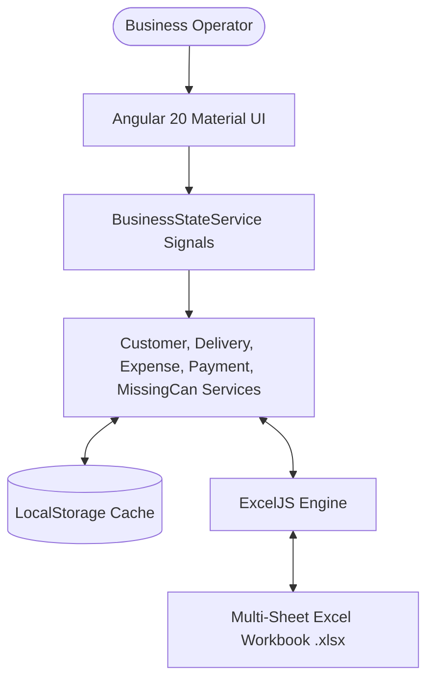

# AquaTrack - Knowledge Transfer (KT) Document & User Manual

Welcome to **AquaTrack**, an enterprise-grade, offline-first Water Can Supply Management System built with **Angular 20**, **Angular Signals**, **RxJS**, **Angular Material**, and **ExcelJS**.

This document serves as an end-to-end Knowledge Transfer (KT) guide for business owners, operators, and developers. It details system architecture, reactive data flow, feature modules, step-by-step onboarding, and daily operations.

---

## 1. System Overview & Architecture

AquaTrack replaces manual Excel spreadsheets with a modern, responsive Angular application while maintaining 100% compatibility with standard Excel workbooks (`.xlsx`).

### Key Technical Characteristics
- **Offline-First & Serverless**: Operates without any backend server. All operational data persists in browser `LocalStorage` and exports directly to `.xlsx`.
- **Reactive State Management**: Built using **Angular Signals** (`computed()` signals). Adding a delivery, payment, expense, or missing can instantly updates customer balances, ledger stats, KPI cards, and trend charts without reloading.
- **ExcelJS Multi-Sheet Synchronization**: Reads and writes multi-sheet Excel workbooks (`Dashboard`, `Customers`, `Daily Deliveries`, `Expenses`, `Profit`, `Missing Cans`, `Payments`, `Settings`) without formatting corruption.

---

## 2. Application Modules & Features

AquaTrack includes 8 core operational modules:

| Module | Purpose | Key Metrics / Actions |
| :--- | :--- | :--- |
| **Login / Authentication** | Secure local operator session | Username: `admin` \| Password: `admin123` |
| **Operations Dashboard** | Real-time business overview | 8 KPI Cards, 4 Trend Charts (Revenue, Expense, Profit, Missing Cans), Recent Deliveries Table, Quick Actions |
| **Customer Directory** | Manage customer accounts & ledgers | Customer ID, Mobile, Area, Address, Security Deposit, Outstanding Cans, Financial Balance, Status |
| **Deliveries Module** | Record daily can supply & returns | Filled Cans Delivered, Empty Cans Returned, Rate/Can, Auto-Calculated Total & Balance, Driver Name, Invoice Printing |
| **Expenses Module** | Track business operating costs | Categories (Fuel, Salary, Maintenance, Electricity, Vehicle, Misc), Daily & Monthly Expense totals |
| **Payments Module** | Customer payments & ledger updates | Record Cash/UPI payments, update customer outstanding balances reactively |
| **Missing Cans Tracker** | Inventory loss & recovery tracking | Track missing vs recovered cans, auto-calculate unrecovered lost cans & replacement cost |
| **Reports Analytics** | Financial & inventory reports | Daily/Weekly/Monthly/Yearly revenue, Net profit margins, Tabbed ledgers, Excel/CSV Export, Print view |
| **Settings & Backup** | System configuration & data sync | Company profile, Can pricing defaults, Dark Mode toggle, Full Multi-Sheet Excel Backup & Restore |

---

## 3. Financial & Inventory Calculation Formulas

AquaTrack maintains deterministic business logic across all modules:

1. **Total Filled Cans Delivered**:
   $$\text{Total Delivered} = \sum \text{Delivery Filled Cans}$$

2. **Total Empty Cans Returned**:
   $$\text{Total Returned} = \sum \text{Delivery Empty Cans}$$

3. **Customer Outstanding Cans**:
   $$\text{Outstanding Cans} = \max(0, \text{Initial Outstanding} + \text{Total Delivered} - \text{Total Returned} - \text{Lost Cans})$$

4. **Delivery Total & Balance**:
   $$\text{Delivery Invoiced Amount} = \text{Filled Cans} \times \text{Rate Per Can}$$
   $$\text{Delivery Balance Due} = \max(0, \text{Delivery Invoiced Amount} - \text{Delivery Paid Amount})$$

5. **Customer Financial Balance (Ledger)**:
   $$\text{Customer Outstanding Balance} = \sum \text{Invoiced Deliveries} + \sum \text{Missing Can Losses} - \sum \text{Payments}$$

6. **Net Daily / Monthly Profit**:
   $$\text{Net Profit} = \text{Total Revenue} - \text{Total Operating Expenses}$$

---

## 4. Step-by-Step User Onboarding Guide

### Step 1: Logging In
1. Open the AquaTrack Web Application.
2. Enter the operator credentials:
   - **Username**: `admin`
   - **Password**: `admin123`
3. Click **Sign In to System** to access the Operations Center.

> [!TIP]
> Check the **Keep session active** box to remember your session on the local device.

---

### Step 2: System Configuration (First-Time Setup)
1. Navigate to **Settings** from the left sidebar.
2. Update **Company Name** (e.g., *AquaTrack Supply Co.*).
3. Set your **Standard Water Can Price** (default: `₹40`).
4. Set your **Standard Customer Security Deposit** (default: `₹500`).
5. Choose your UI preference: **Light Mode** or **Dark Mode**.
6. Click **Save Preferences**.

---

### Step 3: Registering Customers
1. Go to **Customers** module or click **Add Customer** from the Dashboard.
2. Click **Register Customer**.
3. Fill in details:
   - **Customer Name**: e.g., *Rahul Kumar*
   - **Mobile Number**: *9876543210*
   - **Area / Locality**: *Sector 15, Noida*
   - **Address**: Full delivery address
   - **Deposit Amount**: Security deposit paid (e.g., `₹500`)
   - **Initial Outstanding Cans**: Cans currently held by customer
4. Click **Save Customer**.

---

### Step 4: Recording Daily Deliveries & Printing Invoices
1. Go to **Deliveries** or click **Log Delivery** on the Dashboard.
2. Select the **Customer** from the dropdown.
3. Enter:
   - **Filled Cans Delivered**: e.g., `5`
   - **Empty Cans Returned**: e.g., `3`
   - **Rate Per Can**: (auto-populated, e.g., `₹40`)
   - **Paid Amount**: Amount paid on delivery (e.g., `₹100`)
   - **Driver Name**: e.g., *Aman*
   - **Delivery Date**: Select date
4. Notice **Total Amount** (`₹200`) and **Remaining Balance** (`₹100`) auto-calculate instantly.
5. Click **Save Delivery**.
6. To issue a receipt, click the **Print** icon on the delivery row to generate a printable invoice layout.

---

### Step 5: Recording Customer Payments
1. When a customer pays outstanding dues (via Cash/UPI), go to **Payments**.
2. Click **Record Payment**.
3. Select the customer name. The modal displays their current ledger deposit/balance.
4. Enter the **Payment Amount** and **Date**.
5. Click **Save Payment**. Customer ledger balances update reactively across all screens.

---

### Step 6: Recording Business Expenses
1. Go to **Expenses** module.
2. Click **Record Expense**.
3. Select category: **Fuel**, **Salary**, **Maintenance**, **Electricity**, **Vehicle**, or **Miscellaneous**.
4. Enter **Amount** (e.g., `₹1,200` for Fuel) and description.
5. Click **Save Expense**. Dashboard **Today's Expenses** and **Profit** cards update immediately.

---

### Step 7: Managing Missing / Unreturned Cans
1. If cans are misplaced or damaged by a customer, go to **Missing Cans**.
2. Click **Record Missing Can**.
3. Select the customer and enter **Missing Quantity** (e.g., `4`) and **Recovered Quantity** (e.g., `1`).
4. The system calculates **Lost Cans** (`3`) and **Loss Amount** (`₹120`).
5. Click **Save Record**. The loss is accounted in financial reports.

---

### Step 8: Generating Reports & Excel Workbooks
1. Go to **Reports** to view Daily, Weekly, Monthly, and Yearly revenue breakdowns.
2. Switch tabs to inspect:
   - **Customer Outstanding Ledger**
   - **Expenses Breakdown**
   - **Missing Can Losses**
3. Click **Export Excel Report** or **Export CSV** to download formatted spreadsheets.
4. Click **Print Report** for hardcopy audit records.

---

### Step 9: Offline Excel Backup & Restore
1. Go to **Settings** or click **Export Excel** on the top toolbar.
2. Click **Export Backup** to download `aquatrack-workbook.xlsx`.
3. To transfer data to another computer or restore from a saved workbook:
   - Click **Import Workbook**.
   - Select your `.xlsx` file. All 8 sheets synchronize instantly into LocalStorage and UI signals.

---

## 5. Troubleshooting & Best Practices

- **Browser Storage Clean-up**: Do not clear browser cache/cookies without first clicking **Export Excel** in Settings to back up your data.
- **Offline Functionality**: AquaTrack runs completely offline without internet connection once loaded in your browser.
- **Multi-Device Sync**: Use **Export Excel** on Device A and **Import Workbook** on Device B to transfer offline databases seamlessly.

Prompt to migration

# AquaTrack Storage Layer Migration Prompt (Excel → Shared Google Sheets)

Act as a Senior Angular 20 Architect and Migration Engineer.

I already have a fully completed Angular 20 application named **AquaTrack - Water Can Supply Management System**.

## IMPORTANT

This project is already fully developed.

**DO NOT:**

* Create a new Angular project.
* Change the project structure.
* Change the folder structure.
* Change any UI.
* Change any HTML.
* Change any SCSS.
* Change Angular Material components.
* Change Angular Signals.
* Change routing.
* Change business logic.
* Change calculations.
* Change reports.
* Change dashboard calculations.
* Change Excel Import.
* Change Excel Export.
* Rewrite existing modules.

The application is already working correctly.

The **ONLY objective** is to replace the current Excel/LocalStorage storage mechanism with a **shared Google Sheet** so that multiple users (drivers, office staff, admin) can work on the same live data.

---

# Current Architecture

Current Storage Flow

Component

↓

BusinessStateService

↓

LocalStorage

↓

ExcelJS

↓

Excel File

---

# New Required Architecture

Component

↓

BusinessStateService

↓

GoogleSheetService

↓

Google Apps Script Web API

↓

Shared Google Spreadsheet

The Google Spreadsheet becomes the **single source of truth**.

Excel is no longer the primary database.

Excel Import and Excel Export must continue working exactly as before.

---

# Migration Requirement

Do NOT modify any business logic.

Simply replace every LocalStorage/Excel read/write operation with HTTP requests to Google Apps Script.

Every existing component should continue to function without any UI changes.

The only modified layer should be the data source.

---

# Existing Modules (Do Not Modify)

* Login
* Dashboard
* Customers
* Deliveries
* Payments
* Expenses
* Missing Cans
* Reports
* Settings
* Excel Import
* Excel Export

These modules already work correctly.

Only update their storage implementation.

---

# Existing Business Logic (Must Remain Exactly the Same)

Do not modify any calculations.

Keep:

* Outstanding Can Calculation
* Revenue Calculation
* Expense Calculation
* Profit Calculation
* Customer Ledger
* Dashboard KPIs
* Missing Can Calculation
* Payment Calculation

No formula should change.

---

# Existing Signals

Angular Signals are already implemented.

Do not remove them.

Do not rewrite them.

Simply update the signal values after receiving data from Google Sheets.

---

# Replace Only These Operations

Replace

* LocalStorage.getItem()
* LocalStorage.setItem()
* LocalStorage.removeItem()

Replace ExcelJS CRUD operations used as the primary storage.

Instead use

Google Apps Script REST API

through

GoogleSheetService.

---

# Google Spreadsheet

Use one shared spreadsheet.

Spreadsheet Name

AquaTrack Database

The spreadsheet already contains the same sheets as the Excel workbook.

Sheets

* Customers
* Deliveries
* Payments
* Expenses
* MissingCans
* Settings
* Dashboard
* Reports

Do not modify sheet names.

Do not modify column names.

Do not modify column order.

The spreadsheet structure must remain identical to the current Excel workbook.

---

# Google Apps Script

Generate a complete Google Apps Script project.

The script must expose REST APIs.

Support

GET

POST

PUT

DELETE

Return JSON responses.

Enable CORS.

Deploy as Web App.

---

# Angular Changes

Create only one new service

GoogleSheetService

Responsibilities

* Read records
* Insert records
* Update records
* Delete records
* Search records
* Handle HTTP communication
* Retry failed requests
* Handle errors
* Cache data if needed

Do not modify component logic.

Update existing services to call GoogleSheetService.

---

# Services to Update

Only replace their storage implementation.

CustomerService

DeliveryService

ExpenseService

PaymentService

MissingCanService

DashboardService

BusinessStateService

Business logic must remain unchanged.

---

# Auto Refresh

Implement automatic synchronization.

Every 10 seconds

↓

Read latest data from Google Sheets

↓

Update Angular Signals

↓

Refresh Dashboard

↓

Refresh Tables

↓

Refresh Charts

No page reload.

---

# Conflict Handling

If multiple users update simultaneously

Always load the latest data from Google Sheets.

Prevent duplicate customer IDs.

Prevent duplicate delivery IDs.

Use UUIDs and timestamps.

---

# Excel

Keep existing functionality.

Excel Import

Excel Export

Backup

Restore

Do not remove any Excel features.

Excel is now only

* Import Tool
* Export Tool
* Backup Tool

Google Sheets becomes the live operational database.

---

# Error Handling

Handle

* Network failure
* Google Apps Script timeout
* Invalid response
* Missing sheet
* Missing columns
* Duplicate records

Display Angular Material Snackbars.

---

# Environment

Update only

environment.ts

environment.prod.ts

Store

* Google Apps Script URL
* Spreadsheet ID
* Auto Refresh Interval

---

# Deliverables

Generate only the migration code.

Do not generate a new project.

Do not recreate components.

Do not redesign the UI.

Generate

* Google Apps Script
* GoogleSheetService
* Updated existing services
* API integration
* Environment configuration
* Migration guide
* Google Sheet setup guide
* Apps Script deployment guide

The final application must look and behave exactly like the existing AquaTrack application.

The only difference should be that all CRUD operations use one shared Google Spreadsheet instead of LocalStorage/ExcelJS as the primary storage.

